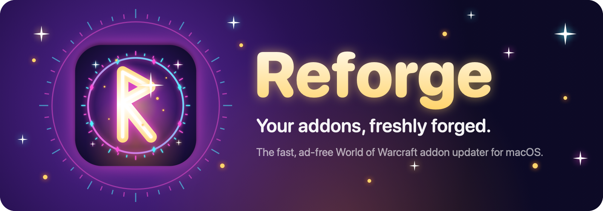
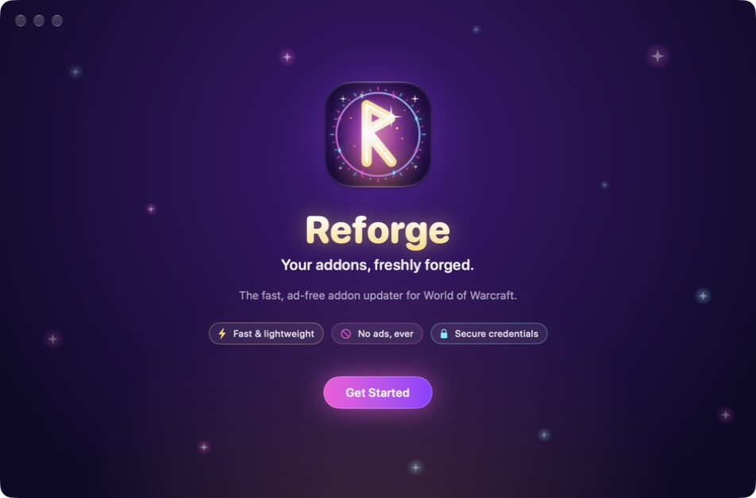
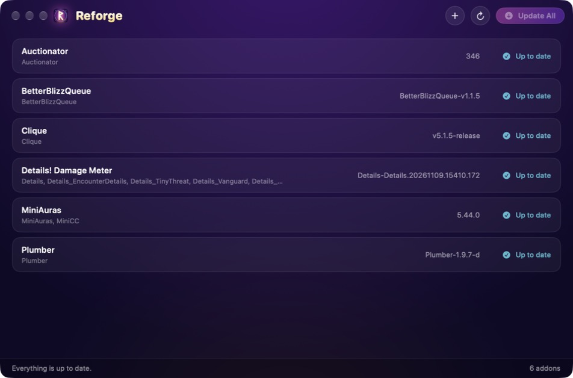

<p align="center">
  
</p>

<p align="center">
  
  
  
  
</p>

**Reforge** is a small, fast, ad-free World of Warcraft addon updater for macOS. Think of it as a lightweight alternative to the CurseForge app: open it, click **Update All**, close it. It doesn't run in the background, show ads or track you.

<p align="center">
  
  
</p>

## ✨ What it does

- **Checks for updates in one click.** It checks CurseForge when it opens (or press ⌘R). Install updates one at a time or all at once.
- **Finds new addons.** Search CurseForge by name or author, or browse what's popular or recently updated, filtered by category and your game version, and install with one click. A pasted CurseForge link or project ID works too.
- **Brings your existing setup along.** If you used the CurseForge app, Reforge reads its local list of installed addons (read-only) and picks up where it left off.
- **Finds addons it doesn't track.** Anything else in your AddOns folder is listed under *Not tracked*. Addons from CurseForge are recognised the way the CurseForge app does it, by fingerprinting their files (or from the project ID in their `.toc`), and track with one click, without downloading anything. The rest (homemade, WoWInterface, Wago, GitHub) show as *Local*.
- **Installs safely.** Old addon folders are set aside during an update and restored if anything goes wrong. Uninstalled addons go to the Trash.
- **Can tell you when to update.** Optionally, turn on **Check for updates while Reforge is closed** in Settings. Every few hours a tiny background check (a LaunchAgent that runs, checks, and exits) sends a notification when an update is out. It never downloads anything by itself and announces each update only once. Turn it off and the LaunchAgent is removed.
- **Stays out of the way.** It quits when you close the window and uses about 0% CPU while open.
- **Supports Retail and Classic.** Switch game versions and opt into beta releases in Settings (⌘,).

## 🔮 Getting started

**Requirements:** macOS 14 or later and the Xcode Command Line Tools (`xcode-select --install`). The full Xcode app isn't needed.

```bash
git clone https://github.com/cwybro/reforge.git
cd reforge
make install
```

That builds the app and installs it as `/Applications/Reforge.app`. Run `make install` again to rebuild after pulling changes, or `make run` to install and open it.

On first launch, a short welcome flow walks you through choosing your AddOns folder, connecting to CurseForge and importing your addons. You can reopen it anytime from **Reforge → Show Welcome Screen**.

### Updates

Every change merged to `main` is built by GitHub Actions and published as a [release](https://github.com/cwybro/reforge/releases) (version `1.0.<build>`). When a newer one is out, Reforge shows a banner when it opens. **Install & Relaunch** downloads it, checks it and replaces the app in place. You can turn the check off in Settings, or run it anytime from **Reforge → Check for Reforge Updates…**.

Releases are signed ad-hoc rather than notarized by Apple. Updates installed by Reforge open normally. If you download `Reforge.zip` from the releases page in a browser instead, macOS will block it the first time: open **System Settings → Privacy & Security** and choose **Open Anyway**. After an update, macOS may ask once more whether Reforge can use its Keychain item (**Always Allow**).

### CurseForge API key

Reforge uses the official [CurseForge API](https://docs.curseforge.com/), which needs a free key for third-party tools. A working key looks like `$2a$10$…`. Keys starting with `cfc_` are a different kind and won't work.

## 🔒 Your data

| What | Where |
|---|---|
| CurseForge API key | Your macOS **login Keychain**. It's never written to a file. |
| Tracked addons and settings | `~/Library/Application Support/Reforge/config.json`, readable only by your user account |
| Background checks (only if turned on) | `~/Library/LaunchAgents/local.reforge.update-check.plist`, plus `background-check.json` (which updates were already announced) next to `config.json` |

Reforge only talks to CurseForge's API and download servers. The repository itself contains no credentials.

Builds are signed locally (ad-hoc), so after a rebuild macOS may ask whether Reforge can use its Keychain item. Click **Always Allow**. While hacking on the app, use `make dev` instead to skip the Keychain entirely.

## 🛠 Development

| Command | What it does |
|---|---|
| `make install` | Build and install to `/Applications` (quits the running copy first) |
| `make run` | Install, then open the app |
| `make build` | Build `build/Reforge Dev.app` (git-ignored): a separate app (bundle ID `local.reforge.dev`) that never competes with the installed `Reforge.app` |
| `make test` | Run the test suite: headless flow tests (Swift Testing) with the network, Keychain and your real folders stubbed out |
| `make e2e` | Build `build/Reforge Dev.app`, then run end-to-end smoke tests that launch it in stub mode (fixture-backed CurseForge, temp settings, recorded installs: no network, Keychain or real AddOns folder) and drive it through the Accessibility API. Opt-in and not part of `make test`. Needs Accessibility permission for your terminal or IDE (System Settings → Privacy & Security → Accessibility); the app runs invisibly and never takes focus |
| `make dev` | Build and open a dev copy that keeps its settings and API key in `./.dev` (git-ignored) instead of Application Support and the Keychain, so rebuilds never trigger Keychain prompts |
| `make icon` | Redraw the app icon |
| `make clean` | Remove build output |

```
Sources/Reforge/          SwiftUI app, CurseForge client, installer, Keychain storage
Tests/ReforgeTests/       Flow tests driving Model with fakes, plus view smoke tests
Tests/ReforgeE2ETests/    Opt-in end-to-end tests driving Reforge Dev.app via Accessibility (make e2e)
Resources/                App icon
scripts/make-icon.swift   Draws the app icon (the ᚱ rune ring)
scripts/make-banner.swift Draws the README banner
docs/                     README images
Package.swift             Swift Package Manager manifest
build.sh                  Packages build/Reforge Dev.app, or Reforge.app for make install
Makefile                  Shortcuts for the above
```

---

<sub>Reforge is an independent project and isn't affiliated with or endorsed by Blizzard Entertainment or CurseForge/Overwolf. World of Warcraft is a trademark of Blizzard Entertainment, Inc.</sub>
